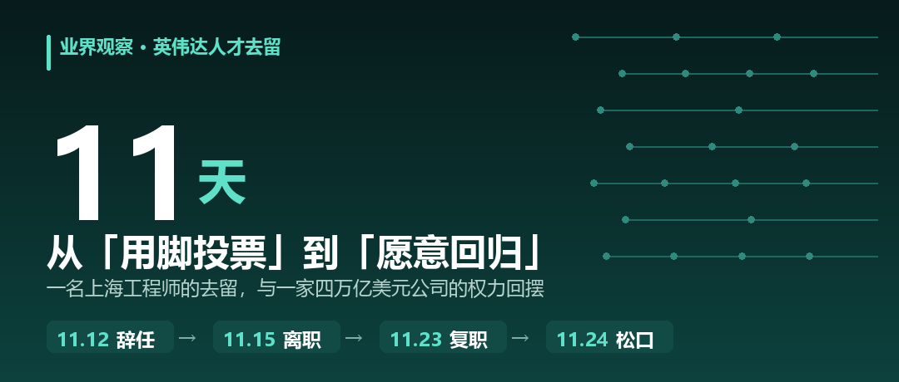
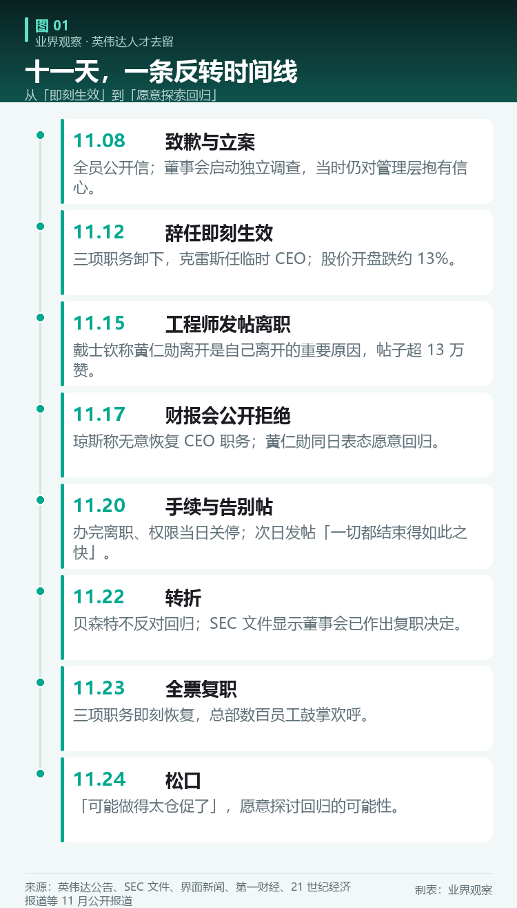
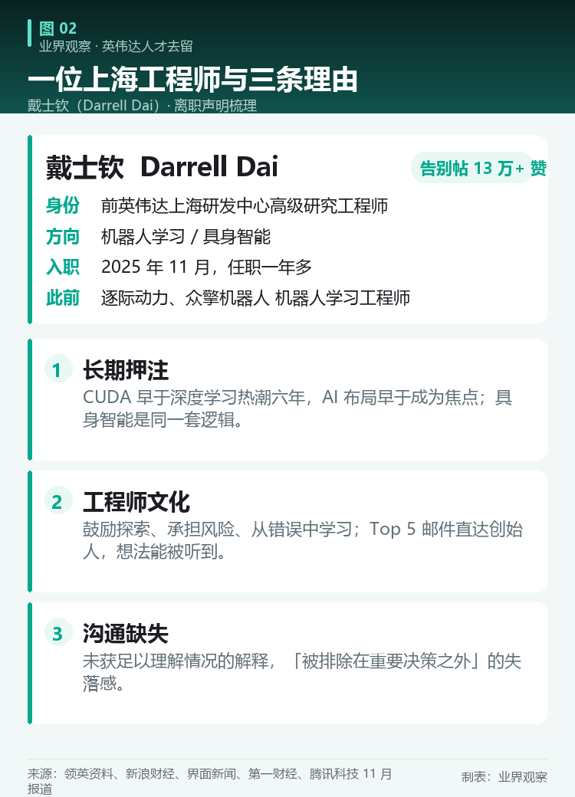
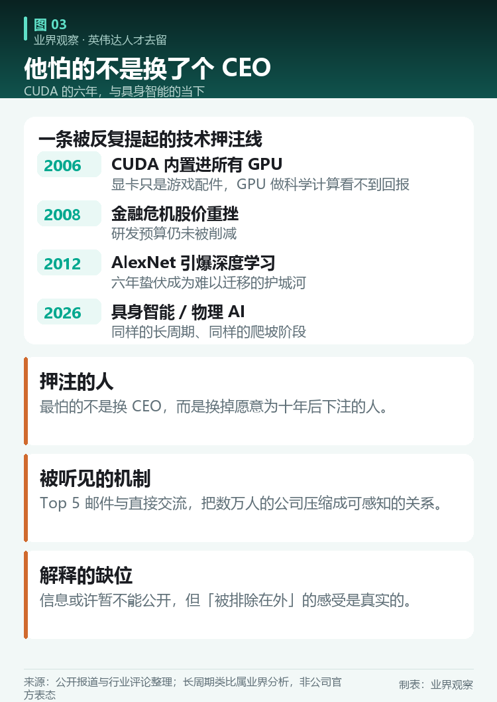
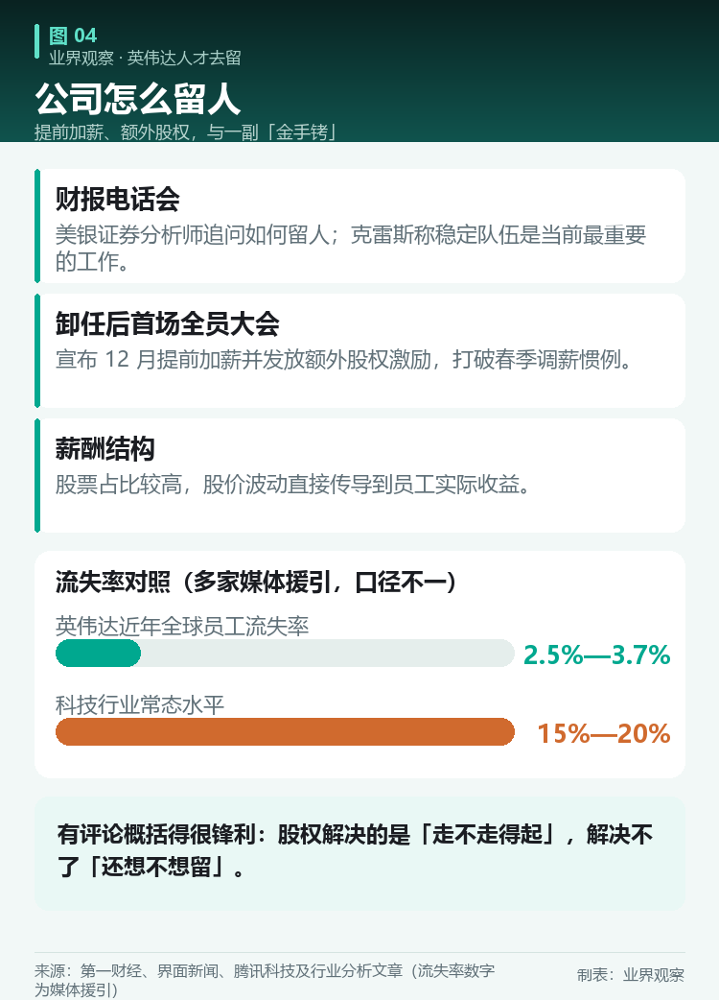
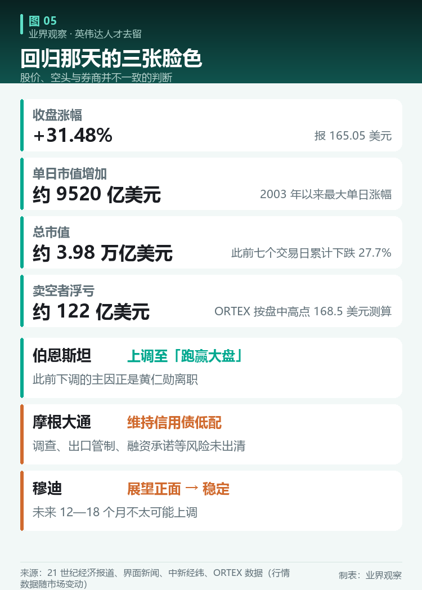
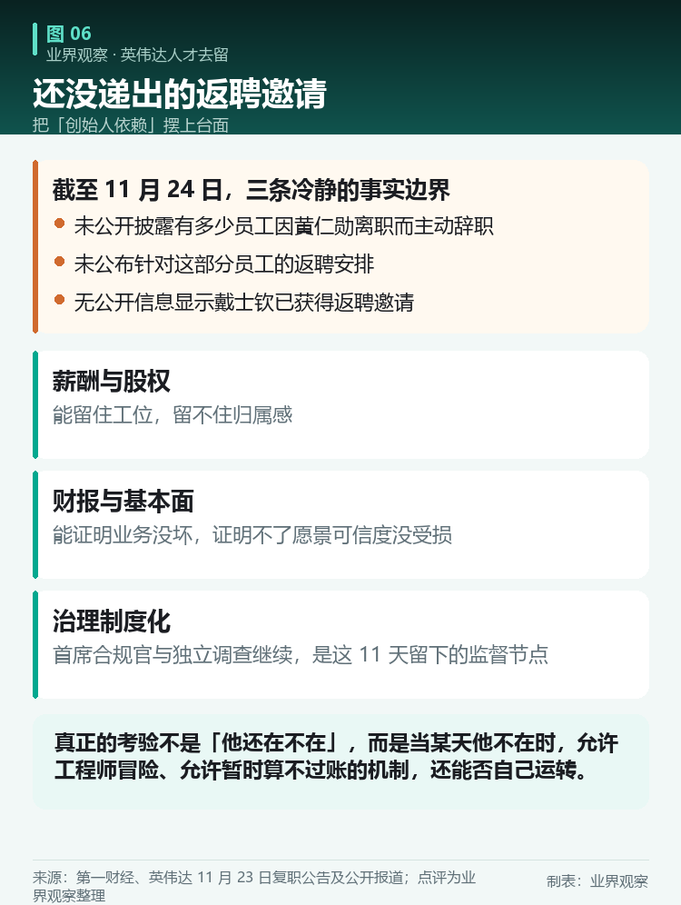

# “我走得有点仓促”：为黄仁勋辞职的工程师，11 天后考虑回英伟达

11 天，足够让一名工程师把工牌交回去，也足够让他重新把“回去”这两个字放回台面上。

11 月 24 日，前英伟达机器人工程师戴士钦（Darrell Dai）在社交平台发文，欢迎黄仁勋回归，并坦言自己此前“可能做得太仓促了”。他写道，眼下想先花些时间休息、反思，认真思考自己的未来，“在这个过程中，我也愿意探索回归的可能性”，但不想再仓促地做出另一个重大决定。

十二天前，正是黄仁勋的离开，促使他决定结束自己在英伟达的职业篇章。一名上海研发中心的工程师，用一次离职为创始人投了票；创始人回来后，他又把这张票收回了一半。这场从辞任到复职不足两周的风波，把一家四万亿美元公司最不容易被写进财报的东西——工程师的归属感——摆到了聚光灯下。

## 01 十一天，一条从“用脚投票”到“想再看一眼”的时间线

要理解这句“我走得有点仓促”，得先把日历往回翻。

11 月 8 日，黄仁勋向全体员工发出公开信，就个人行为致歉；英伟达董事会同日宣布启动独立调查，当时仍表态对黄仁勋及其领导团队抱有信心。11 月 10 日，独立董事聘请纽约南区前代理联邦检察官及其律所协助调查；两天后的 11 月 12 日，公司公告黄仁勋辞去总裁、首席执行官及董事职务，即刻生效，首席财务官科莱特·克雷斯出任临时 CEO，哈维·琼斯出任董事会主席。当天英伟达开盘跌约 13%。

11 月 15 日，戴士钦在社交平台发文宣布离职，明确说黄仁勋的离开是促使自己做出这一决定的重要原因。这条帖子后来获得超过 13 万次点赞。11 月 20 日，他办完离职手续；次日发出告别帖，记录“昨天是我在英伟达的最后一天，我归还了设备和工牌，签完了文件”，并提到账号权限在当天中午就被关停，和一些同事的告别不得不因此中断。

同一时间，公司内部的天平在往另一边压。11 月 17 日的财报电话会上，董事会主席琼斯明确表态“董事会一致接受了黄仁勋的辞呈，无意恢复他的 CEO 职务”；黄仁勋本人则首次表示，如果董事会判断回归符合各方利益，他愿意接受。11 月 22 日，美国财政部长贝森特表示不反对黄仁勋重返英伟达；据英伟达提交给美国证券交易委员会的文件，董事会已于 22 日作出复职决定。

11 月 23 日，公告落地：董事会一致投票，恢复黄仁勋的总裁、首席执行官及董事职务，即刻生效。11 月 24 日，黄仁勋在社交平台补回“英伟达创始人兼首席执行官”的简介，官网管理层页面也把他的名字重新排回首位；同一天，戴士钦发出了那句“愿意探索回归的可能性”。

| 时间 | 节点 | 关键事实 |
| --- | --- | --- |
| 11.08 | 致歉与立案 | 全员公开信；董事会启动独立调查 |
| 11.12 | 辞任生效 | 三项职务即刻卸下，克雷斯任临时 CEO，股价开盘跌约 13% |
| 11.15 | 工程师发帖离职 | 戴士钦称黄仁勋离开是自己离开的重要原因 |
| 11.17 | 财报会公开拒绝 | 琼斯称“无意恢复 CEO 职务”，黄仁勋表态愿归 |
| 11.20—21 | 办完手续与告别帖 | 权限当天中午关停，“一切都结束得如此之快” |
| 11.22 | 转折 | 贝森特不反对回归；SEC 文件显示董事会已作决定 |
| 11.23 | 全票复职 | 三项职务即刻恢复，总部数百员工欢呼 |
| 11.24 | 松口 | “可能做得太仓促了”，愿意探讨回归可能性 |

时间线里最耐人寻味的，不是董事会的 180 度转身，而是两个日期挨得这么近：一个工程师的离职手续办完，到老板回归，只隔了三天。职业决策的速度，第一次被公司治理的节奏甩在了身后。

## 02 他是谁：一位上海工程师，和一条 13 万赞的告别帖

戴士钦不是高管，也不是公众人物。领英资料显示，他于 2025 年 11 月加入英伟达上海研发中心，任高级研究工程师，从事机器人学习、具身智能相关研发，任职一年多；此前曾在逐际动力、众擎机器人担任机器人学习工程师。恰恰是这种“一线研究者”的身份，让他的去留比任何一份内部备忘录都更有说服力。

他的离职声明里，理由写得相当克制，也相当具体。

> 我眼中的黄仁勋不只是英伟达 CEO。我钦佩他投资那些一下子看不到明确前景的未来技术——在深度学习热潮到来之前，他已投入 CUDA；在人工智能成为所有人关注焦点之前，他已布局 AI 领域。这些决策帮助英伟达建立了如今支撑整个 AI 行业的基础设施。

在具身智能方向，他看到了同样的路径：投资机器人技术、分享开源工具与项目、打造把 AI 带进物理世界的计算平台。但对戴士钦来说，比技术路线更重要的，是黄仁勋一手建立的企业文化：工程师被鼓励去探索、承担风险，并从错误中学习；黄仁勋会阅读员工的 Top 5 邮件，关注他们的工作，甚至直接与他们交流。“在这么大的公司里，这种联系很重要。它让每一位工程师都觉得，自己的想法依然能被听到。”

真正让他失望的，是沟通的缺失。据公开报道，他提到在没有得到足以帮助自己理解情况的解释之前，只能接受黄仁勋离开的事实；部分信息或许暂时无法公开，但这并没有改变“被排除在重要决策之外”的感受。他写下一句被多家媒体反复引用的话：一家公司的伟大，源于其领导力、治理机制，以及把愿景变成现实的员工，而员工的信任感和归属感，同样是其中不可或缺的一部分。

换句话说，他走的不是岗位，是那套“允许暂时算不过账”的决策逻辑，以及“我的想法会被认真对待”的确定性。这也是为什么 11 天后一句“愿意探索回归的可能性”，会引来如此密集的转发——它不只是一个人的职业选择，而是一次对工程师文化是否还在的现场投票。

## 03 为什么走：不是薪资，是“长期押注”还能不能继续

把这件事只当成“追星式离职”，会漏掉最有价值的一层。

2006 年英伟达推出 CUDA 时，显卡在多数人眼里只是渲染游戏画面的配件，用 GPU 做科学计算像投入大、回报远的学术玩具。从 2006 到 2012 年 AlexNet 引爆深度学习浪潮，中间是整整六年的持续投入；2008 年金融危机中英伟达股价一度暴跌，CUDA 的研发预算仍未被削减。这套“敢在看不到回报的年份里不砍预算”的判断，后来成了英伟达最深的护城河。

而戴士钦所在的具身智能、物理 AI、仿真环境与世界模型训练管线，处境与当年的 CUDA 高度相似：前期投入巨大，商业化仍在爬坡。有评论据此指出，一名长周期项目的研究者最担心的，从来不是换了个 CEO，而是换掉那个愿意为十年后的答案下注的人——职业经理人的本能是算清每一笔投入多久回本，创始人的本能是赌一个暂时算不过账的方向。这个判断属于业界分析，不是公司官方表态，但它精准解释了告别帖里为什么专门提起 CUDA。

另一层是“被听见”的机制。Top 5 邮件、直接交流、鼓励从错误中学习，这些做法把一家数万人的公司压缩成一种可感知的关系：工程师相信自己的技术判断能绕过层级，抵达最终拍板的人。管理层突然更迭且解释不足时，被打破的正是这层关系，而不是薪酬数字。

值得注意的是，英伟达当时并非没有反击。11 月 17 日发布的 2027 财年第三财季财报相当亮眼：营收 1158 亿美元、同比增长 103%，净利润 653 亿美元，均超出市场预期。基本面并没有塌，塌的是一部分人对“未来还会被这样下注”的预期。这两者之间的落差，正是这 11 天最值得记录的地方。

## 04 公司怎么留人：提前加薪、额外股权，和一副“金手铐”

英伟达的应对很快，而且直接指向钱。

在 11 月中旬黄仁勋卸任后的首场全员大会上，临时 CEO 克雷斯宣布，把原本按惯例在春季进行的年度薪酬调整提前：12 月给员工加薪并发放额外股权激励。此前的财报电话会上，美国银行证券的分析师直接追问，面对如此重大的管理层变动，公司将如何留住人才、如何保证长期经营稳定性；克雷斯回应称，稳定员工队伍可能是管理层当前最重要的工作，公司相信员工“致力于在英伟达完成自己毕生的事业”。

这个回答有它的底气。由于英伟达员工薪酬包中股票占比较高，股价波动会直接传导到实际收益；而多家媒体援引的数据显示，英伟达近年全球员工流失率长期处在 2.5%—3.7% 区间，显著低于科技行业 15%—20% 的常态水平（不同报道的统计口径与年份并不一致）。四年期限制性股票叠加员工购股折扣，构成了业内常说的“金手铐”：对多数人来说，提前一年离开意味着放弃一大笔尚未归属的股票。

但这次风波也把金手铐的边界画了出来。有评论概括得相当锋利：股权解决的是“走不走得起”，解决不了“还想不想留”。对已经实现财务自由的核心技术骨干来说，外部递来的空白支票从来不缺，缺的是一个“我的想法还会被认真对待”的信号。

第一财经记录的一个细节，恰好提供了另一种视角：一名刚拿到英伟达 offer 的求职者说，黄仁勋离任后公司内部信心确实有所下降，实习生对转正的信心不如从前，也听说有员工开始向外投递简历；但在回归消息公布前两小时，这名求职者最终拒绝了 offer，理由是“原先的考虑层次就在岗位间的对比上，黄仁勋在不在公司，不会成为我是否接受 offer 的主要原因”。有人为创始人离开，有人根本不把他列为变量——同一场震荡里，个体判断的分化本身就值得记下。

## 05 回归那天：股价、空头与华尔街的三张不同脸色

11 月 23 日，英伟达总部大厅聚集了数百名员工，鼓掌、欢呼，齐声高喊"Jensen"。黄仁勋身穿黑色行政夹克现身，笑称这是自己“第一天上班”，还需要 IT 部门配一台新电脑；随后向员工鞠躬致歉，承认自己犯下严重错误，感谢大家给第二次机会，承诺“会成为一个更好的 CEO”。次日全员大会上，他再次致歉，承认相关行为违反公司商业行为准则。

资本市场的反应更为剧烈。当日英伟达收盘大涨 31.48%，报 165.05 美元，总市值约 3.98 万亿美元，单日市值增加约 9520 亿美元，创下 2003 年以来最大单日涨幅；而在此之前的七个交易日，股价累计下跌 27.7%，一度触及 52 周新低。据数据服务商 ORTEX 测算，以盘中高点 168.5 美元计，全市场卖空者当日账面浮亏约 122 亿美元，是该机构自 2019 年统计以来规模最大的单日亏损。另有报道称，“木头姐”Cathie Wood 旗下资管在 11 月 16 日至 20 日间出售 712282 股英伟达股票，按周一收盘价计算错失约 1070 万美元潜在收益。

券商的观点并没有跟着股价一起单边转多。伯恩斯坦把评级上调至“跑赢大盘”，理由直白：此前下调的主因正是黄仁勋离职，人回来了，理由就消失了。摩根大通则维持对英伟达信用债的低配评级，认为调查、出口管制不确定性与融资承诺等风险仍未出清；穆迪把评级展望从正面下调至稳定，并称未来 12 至 18 个月内不太可能上调。同一份公告，短线交易者读成利好，信用分析师读成“治理问题刚刚开始被定价”。

容易被忽略的是公告里的制度条款：董事会此前成立的独立调查委员会将继续推进调查，公司将新设首席合规官职位，并继续配合政府相关调查；克雷斯结束临时 CEO 职责、回任 CFO，琼斯继续担任董事会主席。人回来了，但这 11 天新长出来的监督节点并没有随之撤掉。

## 06 还没递出的返聘邀请：把“创始人依赖”摆上台面

到这里，必须守住一条事实边界。

截至 11 月 24 日，英伟达尚未公开披露有多少员工因黄仁勋离职而主动辞职，也未公布针对这部分员工的返聘安排；目前没有公开信息显示戴士钦已经获得英伟达的返聘邀请。有英伟达内部人士对媒体表示，没有听到公司有返聘相关安排。所以，“愿意探讨回归的可能性”仍是个人层面的表态，而不是一次已经发生的回聘。把它读成“工程师已经回归英伟达”，是这轮传播里最常见的误读。

但这恰恰是这篇报道最值得留下的部分。有分析人士认为，英伟达历史上远低于同行的员工流失率，很大程度源于员工对黄仁勋本人及其工程师文化的认同；一旦最高权力更迭，公司就可能面临核心人才流失风险。低流失率既是护城河，也是一种单点依赖——它把“公司值不值得留”这个问题，过多地系在一个人身上。

把三个切面叠起来看，结论比“后悔了”三个字复杂得多：薪酬与股权能留住工位，留不住归属感；财报能证明业务没坏，证明不了愿景的可信度没受损；董事会可以把创始人请回来，却必须靠首席合规官、独立调查和常态化的沟通机制，去补上这 11 天暴露出的制度缺口。对一家把长周期技术押注写进基因的公司来说，真正的考验不是“他还在不在”，而是当某一天他不在时，那套允许工程师冒险、允许“暂时算不过账”、允许想法被听见的机制，是否还能自己运转。

戴士钦说，希望以更清醒的头脑面对接下来的选择。这句话对工程师成立，对英伟达同样成立。

---

### 参考信源

- 界面新闻《因黄仁勋辞职而出走的工程师后悔了：愿意考虑重回英伟达》，2026 年 11 月 25 日（新浪财经、同花顺、腾讯新闻等多平台转载）
- 第一财经《因创始人黄仁勋辞任而离职的工程师，在老板回归后松口了》，2026 年 11 月 25 日
- 新浪财经《曾因黄仁勋离职而辞职，如今又想回英伟达！上海工程师：当初决定太草率》，2026 年 11 月 25 日
- 环球网科技频道、澎湃新闻、凤凰网、IT 之家关于戴士钦离职与复职动态的报道，2026 年 11 月 15—24 日（部分媒体将发文日期记为 11 月 14 日，本文按多数权威报道采用 11 月 15 日）
- 21 世纪经济报道《11 天反转：黄仁勋重掌英伟达 市值一夜回补 1 万亿美元》，2026 年 11 月 24 日
- 中国金融新闻网《英伟达人事风波背后的 AI 产业博弈》，2026 年 11 月 25 日
- 南方新闻网《11 天，黄仁勋经历了什么？》、界面新闻《商业头条 No.153｜黄仁勋归来》，2026 年 11 月 24 日
- 英伟达官网 11 月 12 日辞任公告、11 月 23 日复职公告及提交 SEC 的相关文件（公开报道转述）
- 网易、今日头条等平台关于英伟达员工流失率、股权激励与 CUDA 长期投入的行业分析文章（相关数字为媒体援引与业内估算，口径不一，仅作背景参考）
