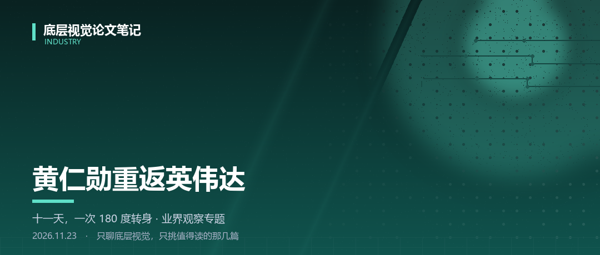
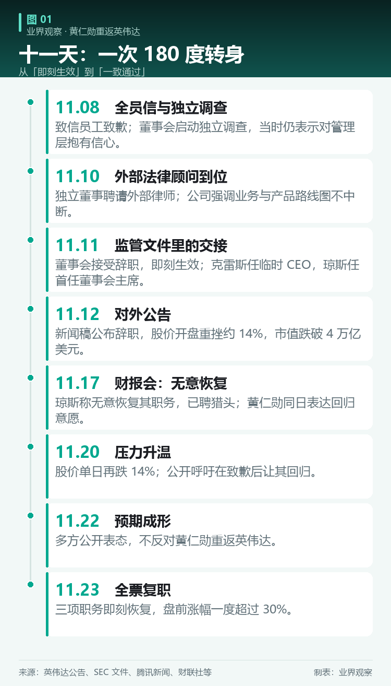
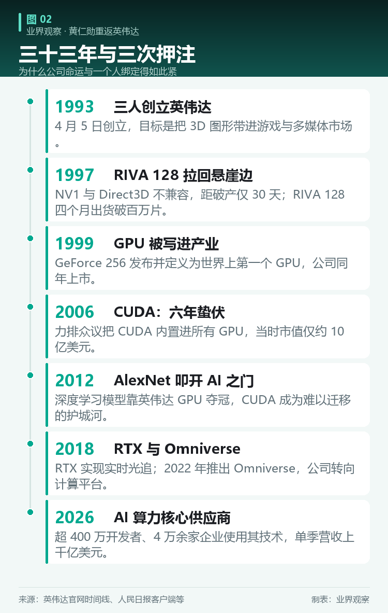
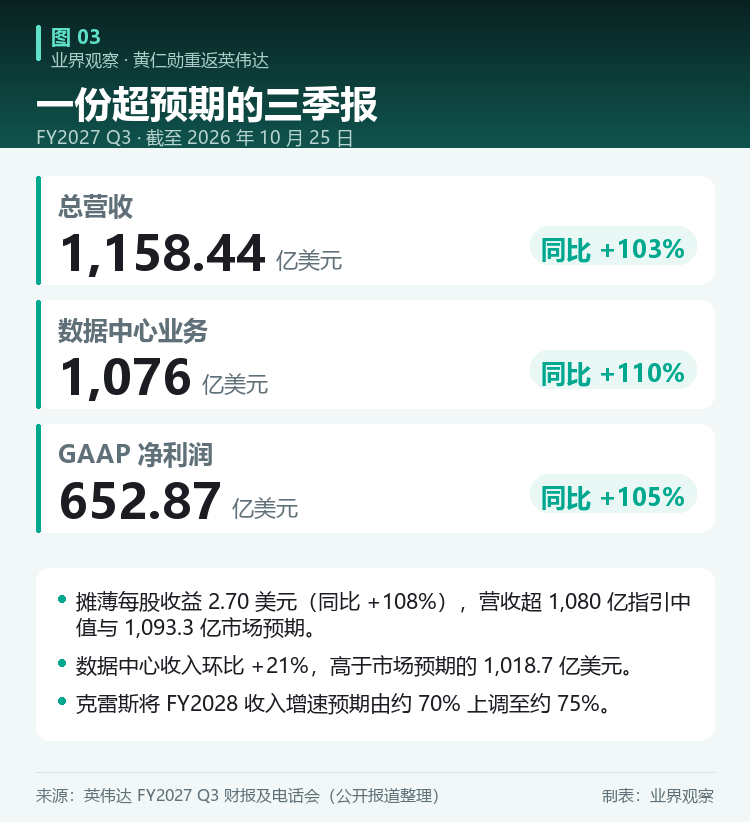
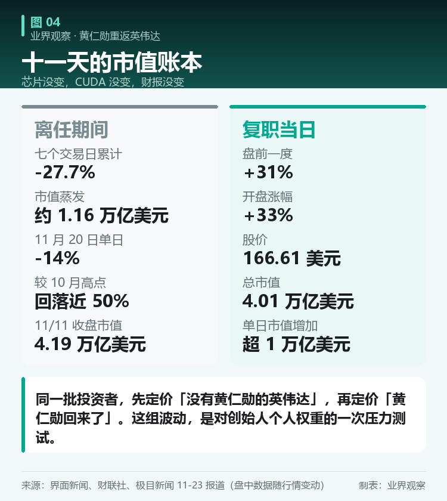
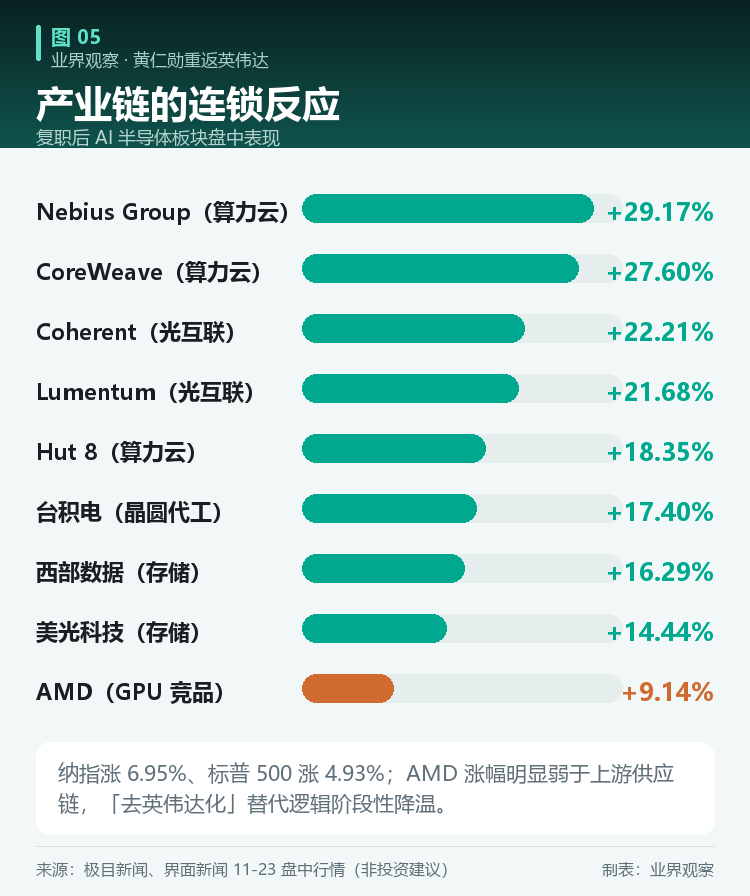
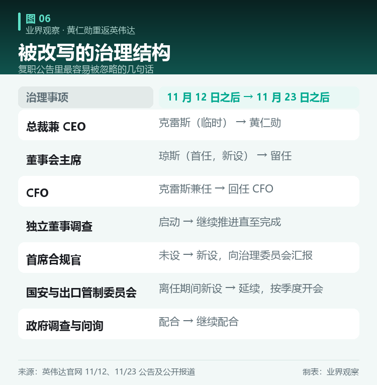

# 黄仁勋重返英伟达

> 编者说明：本文只讨论公司治理、领导层交接与 AI 算力产业影响。涉及的个人事项仅引用英伟达官方公告与权威媒体公开表述，不展开、不作定性；媒体援引知情人士的说法以及仍在进行的独立调查、政府问询，均以官方公告与最终调查结论为准。文中行情数据为 2026 年 11 月 23 日盘前或盘中公开报道数值，随行情变动，不构成投资建议。

北京时间 11 月 23 日晚，英伟达官网发布公告：董事会一致投票决定，即日起恢复黄仁勋的总裁、首席执行官及董事会成员职务。此时距公司 11 月 12 日对外宣布他辞去全部职务，仅过去 11 天。公告落地后，英伟达美股盘前涨幅一度超过 30%，开盘跳涨约 33%，市值单日增加超 1 万亿美元，总市值重回 4 万亿美元上方。一家四万亿美元公司的估值，在十一天里跟着一个人的去留被反复重定价——这已经不是一次普通的人事任免，而是对「创始人个人在一家基础设施级公司里究竟占多大权重」的一次公开压力测试。

## 01. 十一天：从「即刻生效」到「一致通过」

把时间拨回 11 月 8 日。当天黄仁勋向全体员工发出公开信，就个人行为致歉；英伟达董事会同日宣布启动由独立董事组成的独立调查，并聘请独立法律顾问协助。那份声明里，董事会仍写明对黄仁勋及其领导团队「抱有信心」，他继续以首席执行官身份履职。此时看，这更像一次可控的声誉危机。

真正的职务变更发生在 11 月 11 日。英伟达提交给美国证券交易委员会的临时报告载明：董事会当天接受黄仁勋辞去总裁、首席执行官和董事职务，即时生效。同日，执行副总裁兼首席财务官科莱特·克雷斯（Colette Kress）出任临时 CEO，资深董事哈维·琼斯（Harvey C. Jones）出任公司首任董事会主席，正式 CEO 遴选同步启动，内部与外部人选都在考虑范围。公众看到新闻稿是 11 月 12 日——这就解释了为什么「离任 11 天」和「离任 12 天」两种说法都成立：前者从对外公告起算，后者从监管文件里董事会作出决定的那天起算，回答的本来就是两件不同的事。

11 月 17 日的财报电话会，是这场风波里最富戏剧性的一幕。琼斯告诉投资者，董事会「无意」让黄仁勋重新担任 CEO，并已聘请猎头公司海德思哲推进继任者遴选；同一天，黄仁勋在离任后的首次公开声明里表示，如果董事会判断回归符合各方利益，他将很荣幸重新出任 CEO。一个人公开表达回归意愿，一家公司已经请人寻找新掌门，两件事在当时同时成立，外界还等不到一份新的任命书。

六天后的 11 月 23 日，同一位董事会主席代表董事会欢迎他回来。官方公告给出的理由是：经过一系列讨论和会面，董事会对黄仁勋的坦诚程度及领导公司的能力表示认可；决策过程中听取了美国政府高层的意见，并据此确信复职不会带来国家安全风险。董事会披露了作决定时考虑的因素，没有公开每场会谈的内容及各项因素所占的分量。

| 日期 | 关键动作 | 职务状态 |
| --- | --- | --- |
| 11 月 8 日 | 全员信致歉；董事会启动独立调查 | 仍任总裁、CEO、董事 |
| 11 月 11 日 | SEC 临时报告接受辞职；克雷斯任临时 CEO，琼斯任首任董事会主席 | 三项职务即刻终止 |
| 11 月 12 日 | 对外发布新闻稿；启动正式 CEO 遴选 | 临时管理层接管 |
| 11 月 17 日 | 财报会称「无意恢复」；聘猎头；黄仁勋表达回归意愿 | 克雷斯主持业务 |
| 11 月 23 日 | 董事会全票通过复职，即刻生效 | 三项职务恢复 |

这里有一个必须分清的边界：私人事项由当事人自己承认，涉及公司行为准则、合规与国家安全疑虑的问题则交给独立董事委员会与外部律师核查，两条线在公告里始终是分开写的。本文不展开前者，也不对其作定性——它既不是产业分析的变量，也不该成为判断这家公司价值的依据。

图 1｜十一天关键节点时间轴。「11 天」按 11 月 12 日对外公告起算，按 SEC 文件中董事会作出决定的 11 月 11 日起算则为 12 天。

## 02. 三十三年与三次押注：为什么是「他」

要理解市场为何对一个人的去留如此敏感，得回到 1993 年 4 月 5 日。30 岁的黄仁勋与 Chris Malachowsky、Curtis Priem 共同创立英伟达，最初的目标只是把 3D 图形带进游戏与多媒体市场。此前他 1984 年从俄勒冈州立大学毕业，先后在 AMD 与 LSI Logic 任职。

这家公司此后三十三年的关键关口，几乎都由他拍板。首款产品 NV1 因与微软 Direct3D 标准不兼容而积压，公司一度距破产仅 30 天；与世嘉合作的一笔订单换来数月喘息，1997 年 RIVA 128 上市四个月出货突破 100 万片，把英伟达从悬崖边拉了回来。1999 年 GeForce 256 发布，英伟达把它定义为「世界上第一个 GPU」，这个词从此进入整个产业，图形计算的边界被重新划定。

真正改变公司性质的是 2006 年的 CUDA。把通用并行计算能力内置进所有 GPU，意味着极高的当期成本，而当时英伟达市值仅在 10 亿美元量级，股东质疑持续多年。黄仁勋用 GTC 大会在全球推广这套生态，蛰伏六年后，2012 年 AlexNet 依靠英伟达 GPU 拿下图像识别大赛冠军，深度学习的大门被推开，CUDA 瞬间从「不务正业」变成难以迁移的护城河。他后来把世嘉危机、CUDA 的长周期投入、以及 2010 年前后进入手机基带市场又果断退出，并称为公司历史上三次几乎致命的失败；三次的共同点，都是在短期收益与长期路线之间选了后者。

到 2026 年，英伟达早已不是显卡公司。官方时间线称超过 400 万开发者、4 万余家企业在使用其技术；单季营收站上千亿美元量级，数据中心业务贡献绝大部分增长。从图形芯片到 AI 算力基础设施，这条路线图上每一个转折点都带着强烈的个人判断色彩——这也是为什么「谁坐在那个位置上」会被市场单独定价。

图 2｜三十三年技术里程碑。自绘依据英伟达官网公司时间线与公开报道，非产品实物图。

## 03. 一份超预期财报，止不住的股价

黄仁勋离任期间，英伟达交出的是一份相当漂亮的财报。FY2027 第三季度（截至 2026 年 10 月 25 日）营收 1,158.44 亿美元，同比增长 103%、环比增长 20%，既高于公司 1,080 亿美元的指引中值，也高于市场预期的 1,093.3 亿美元；数据中心业务收入 1,076 亿美元，同比增长 110%，超出市场预期的 1,018.7 亿美元；按 GAAP 口径，季度净利润 652.87 亿美元，同比增长 105%，摊薄每股收益 2.70 美元。克雷斯在电话会上还把 FY2028 收入增速预期由约 70% 上调至约 75%。

图 3｜FY2027 Q3 核心财务数据。财报发布于黄仁勋离任期间，业务口径未受人事变动影响。

但财报没有止住跌势。从 11 月 12 日到 11 月 20 日的七个交易日，英伟达累计下跌 27.7%，市值蒸发约 1.16 万亿美元；11 月 20 日单日下跌 14%，股价较 10 月高点回落近 50%。11 月 23 日复职消息落地，盘前涨幅一度扩大到 31%，开盘跳涨约 33%，股价报 166.61 美元，市值单日增加超 1 万亿美元，总市值回到 4.01 万亿美元。同期纳斯达克综合指数涨 6.95%，标普 500 涨 4.93%。

图 4｜十一天的市值账本。左栏为离任期间回撤，右栏为复职当日反弹，均为公开报道的盘中数值。

把这组数字并列起来看，结论相当直白：在这十一天里，英伟达的芯片没有变，CUDA 生态没有变，数据中心收入与后续指引也没有变。变的只有一个人是否坐在 CEO 的位置上。市场先定价「没有黄仁勋的英伟达」，再定价「黄仁勋回来了」，中间那段落差，就是创始人个人判断力在这家公司估值里被单独剥离出来的权重。一份超预期财报没能托住股价，一条复职公告却让市值单日回补一万亿美元，这本身比任何评论都更能说明问题。

## 04. 产业链的连锁反应：市场买的是确定性

复职消息之所以能带动整个板块，原因在于它消除的是供应链最担心的一类不确定性：产品迭代节奏、GPU 供货安排与算力订单交付，会不会因为管理层真空而漂移。

盘面上游环节反应最剧烈。算力云厂商 Nebius Group、CoreWeave、Hut 8 分别上涨 29.17%、27.60%、18.35%；光互联供应商 Coherent、Lumentum 上涨 22.21%、21.68%；晶圆代工龙头台积电上涨 17.40%，美光科技、西部数据分别上涨 14.44%、16.29%；交换机厂商 Arista Networks 同步走强，微软、Meta、亚马逊、谷歌等核心大客户股价同样上涨。对手里有订单、正在安排交付的客户来说，接下来由谁代表公司解释经营计划，比人事传闻本身更直接。

图 5｜产业链主要标的盘中涨幅。AMD 作为竞品以橙色标出，涨幅明显弱于上游供应链。

另一个方向的信息同样重要：作为最直接竞品的 AMD 当日涨 9.14%，明显弱于英伟达与上游供应链。此前市场交易的「云厂商分散供应链、加大第二供应商采购」预期边际弱化，「去英伟达化」的替代逻辑阶段性降温。但窗口一旦被打开就不会自动关上——在这十一天里，客户做 2027 年规划时第一次把「如果没有英伟达的卡，B 计划是什么」写进了采购讨论；公开报道提到，博通的定制 ASIC 订单积压约 730 亿美元。这类变化不会因为一次复职就原路退回。

支撑回归的声音也值得记录：Altimeter Capital 创始人布拉德·格斯特纳与 Atreides Management 负责人加文·贝克联名致信董事会，呼吁在决定未来领导层安排时保持审慎、保留包括黄仁勋可能回归在内的所有选项；马斯克把让其离开比作「在球队连胜时把迈克尔·乔丹踢出队伍」，并在复职公告后转发称「错误已被纠正」；一份公开请愿在数日内收集到超过 20 万个签名。这些不是情绪注脚，而是董事会决策时必须计入的利益相关方压力。

## 05. 回来的不只是他：治理结构被改写

如果把视线从黄仁勋个人移到会议桌另一端，11 月 23 日之后的英伟达，已经不是 11 月 11 日之前那家公司。

复职公告里最容易被忽略的，是紧随其后的几句安排：由独立董事组成的委员会将继续调查直至完成，黄仁勋表示支持并承诺配合；公司将新设首席合规官，负责全公司合规事务并向提名与公司治理委员会汇报；公司将继续配合正在进行的政府调查和问询。琼斯留任董事会主席——这个「首任董事会主席」职位本身就是离任期间新设的；克雷斯结束临时 CEO 任期，回任 CFO；离任期间新设的国家安全与出口管制监督委员会，也有了按季度开会的安排。

图 6｜治理结构对比。复职恢复了三个职务，但没有恢复原来的权力边界。

美国总统特朗普在第一时间称董事会作出了「正确且恰当的决定」，同时要求公司继续全面开展内部调查、审查出口管制合规。换句话说，复职解决的是经营层面的不确定性，不是合规层面的全部问题：独立调查、政府问询、出口管制审查，都仍在各自的进度条上。

过去三十三年，英伟达的治理结构大体是「创始人拍板、董事会背书」。这十一天证明董事会既有能力收回授权，也用首席合规官与专门委员会把「收回」这件事制度化了。黄仁勋拿回了三个职务，但权力边界上多出了新的监督节点。对股东而言，11 月 23 日已经有了一个可以据以行事的结论；至于调查最终查明什么，则要等负责调查的人作出说明。

## 06. 结语：权杖旁边多了一双眼睛

到 2026 年 11 月 23 日，英伟达的芯片路线图仍排到 2028 年，CUDA 仍没有等量级的替代品，黄仁勋仍坐在那个位置上。就产业地位而言，什么都没有被推翻。

但这次回去，他是带着调查委员会与首席合规官一起回去的。十二天的人事交接有了终点，治理层面的调整才刚刚开始。而这场风波留给产业更长久的启示，或许并不在人事本身：当一家公司的技术路线、客户关系、供应链节奏与资本市场预期高度系于一个人，这份集中度本身就是一种需要被定价、也需要被制度对冲的风险。市场用一万亿美元的波动，把这件事说得很清楚了。

---

### 参考信源

- 英伟达官网新闻稿《NVIDIA Board Reinstates Jensen Huang as President, CEO and Board Director》，2026 年 11 月 23 日
- 英伟达官网公司时间线（Corporate Timeline）
- 中国新闻网《英伟达董事会一致通过黄仁勋复职：恢复总裁兼 CEO 职务，相关调查仍将继续》，2026 年 11 月 23 日
- 科技日报《一致决定！黄仁勋重新出任英伟达 CEO》，2026 年 11 月 23 日
- 腾讯新闻《离任十二天后重返英伟达，黄仁勋经历了怎样的一次交接》，2026 年 11 月 23 日
- 财联社、界面新闻、极目新闻、正观新闻、中国新闻周刊、人民日报客户端等 2026 年 11 月公开报道
