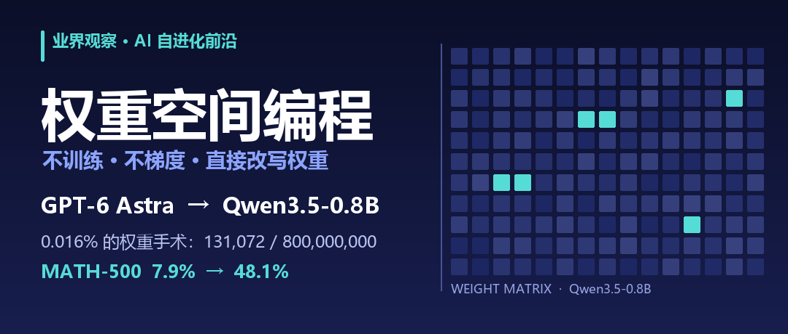
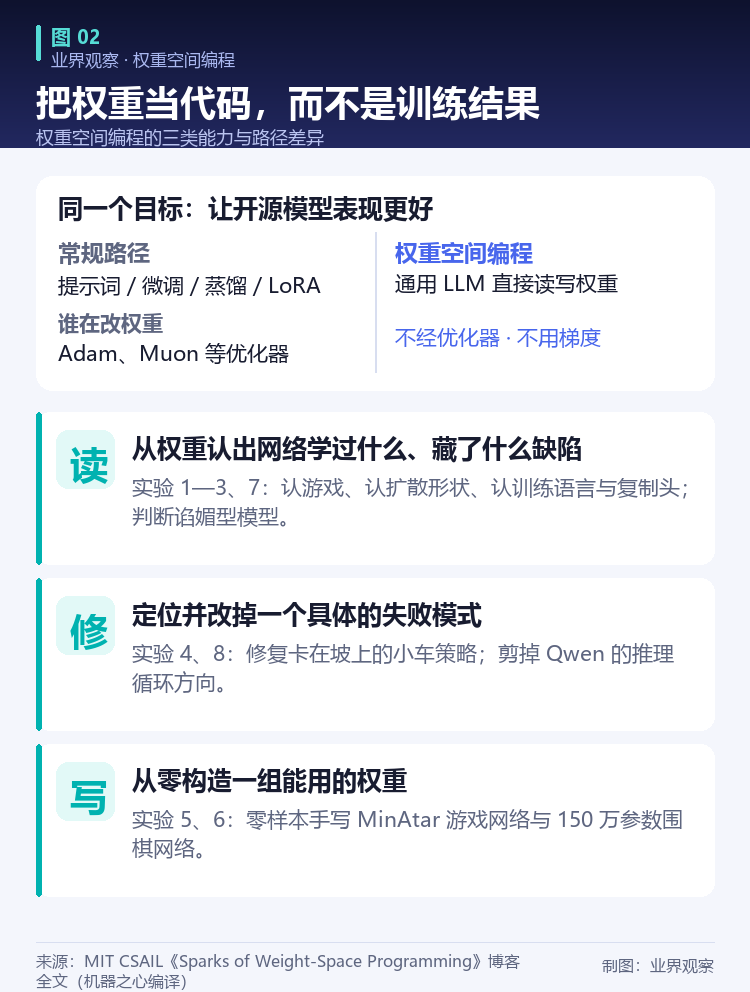
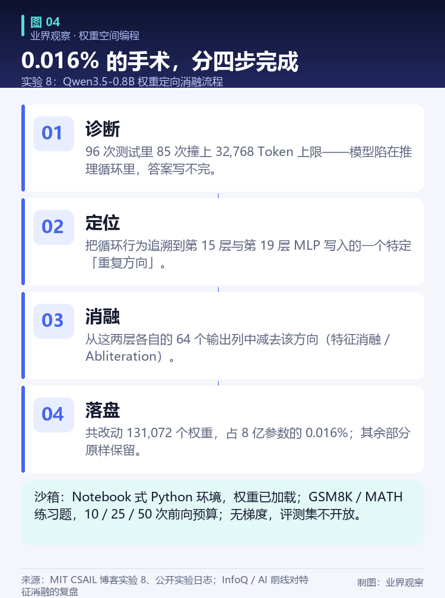
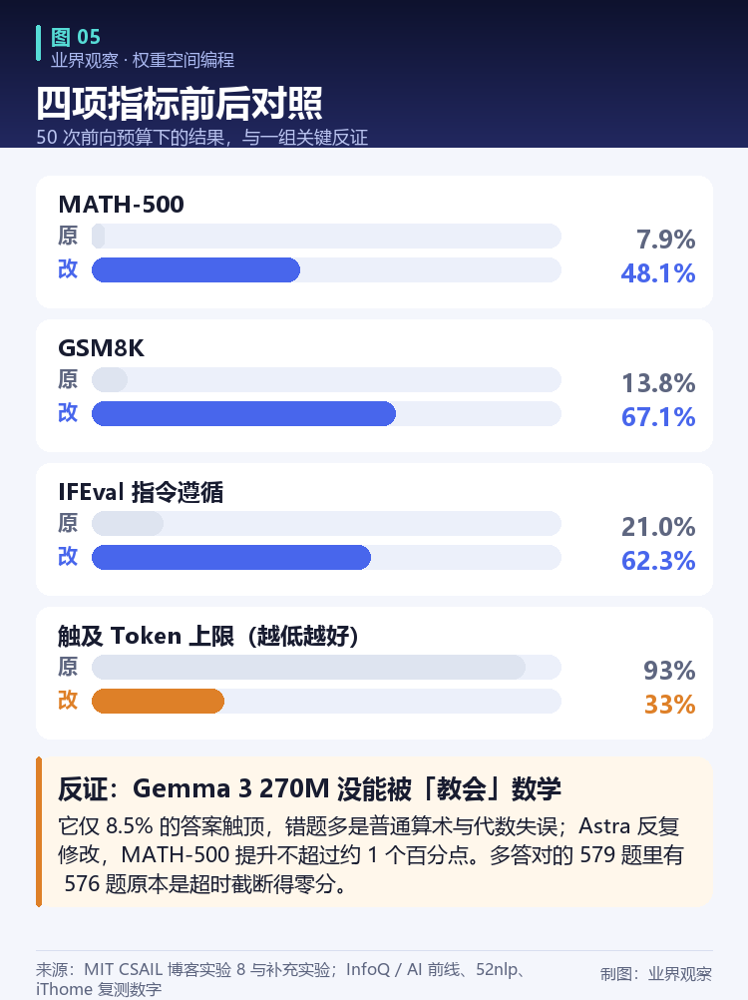
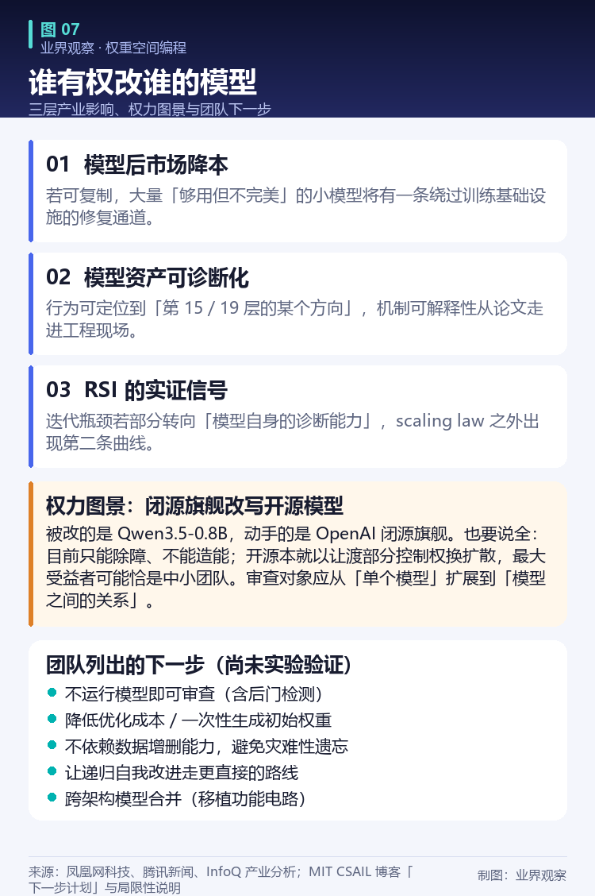

# 不训练、不反向传播：MIT 让 GPT-6 Astra 直接改写 Qwen 权重

把一个训练好的神经网络摊开，只给另一个模型看那一串浮点数，它能看出这个网络学会了什么吗？如果再允许它动手改掉其中一小部分数字，能不能让这个网络变得更聪明？

11 月 2 日，MIT CSAIL 的四位研究者把这个问题从思想实验搬进了实验日志。他们让 OpenAI 的前沿模型 GPT-6 Astra 直接读取并修改阿里 Qwen3.5-0.8B 的权重，在不动优化器、不做梯度下降、不重新训练的条件下，只改动 131,072 个数字——占这个 8 亿参数模型的 0.016%——就把它在 MATH-500 上的成绩从 7.9% 拉到 48.1%。

一天之内，截图刷屏中文互联网，X 原帖 14 小时浏览量超过 550 万。但真正让这件事值得写下来的，不是那个「6 倍」的分数，而是接下来 48 小时里发生的一次高质量反转：一线研究员翻出公开日志与系统提示词，指出最亮眼的结果既不是「凭权重直觉」，也不是「凭空造出数学能力」；与此同时，有人用一台笔记本上的开源模型，独立复现了其中最反常识的那一半。

团队把这套做法命名为权重空间编程（Weight-Space Programming，WSP）。它可能没有宣传里那么像魔法，但它确实把「模型能不能直接读写模型」这件事，第一次推到了可以被逐行检查的位置。

## 01 一张博客，48 小时刷屏与反转

先把时间线摆清楚。

2026 年 11 月 2 日，MIT CSAIL 的 Rikiya Takehi、Jayden Teoh、Alex Zhang 与 Omar Khattab 在个人博客发布《Sparks of Weight-Space Programming: LLMs can natively read & write neural network weights》。这不是一篇经过同行评审的论文，而是一组早期实验报告——但团队同时公开了完整实验日志（GitHub 上的 RikiyaT/lm_understand-logs）、改写后的 Qwen3.5-0.8B 权重（Hugging Face，Apache-2.0），以及一个可以拿自己的题目对比基线与编辑版模型的 Space。任何人都能复测，这也成了后续争论能迅速落到证据层面的前提。

11 月 3 日，机器之心编译了博客全文，腾讯新闻、新浪科技、凤凰网科技、iThome、TechOrange 等跟进，「GPT-6 徒手修好千问小模型」成为中文技术圈的热门话题。凤凰网科技记录，X 原帖在 14 小时内浏览量超过 550 万；另有报道给出近 600 万、超 700 万的不同时间点快照，Hacker News 上则聚集了多个相关热帖与数百条评论。

反转来得同样快。11 月 3 日至 4 日，spaCy 作者、Explosion 联合创始人 Matthew Honnibal 发文批评报告把两类性质不同的实验混在一篇里；Hacker News 上的反驳帖拿到 800 分以上。同一时间，Datasette 作者、Django 联合创建者 Simon Willison 在笔记本上独立复现了「无工具读权重」的部分。11 月 7 日，InfoQ／AI 前线汇总了 Meta 研究员 Lucas Beyer 等人的质疑，《GPT-6 自主爆改 Qwen 权重被吹成神？》把分歧彻底摊开。

| 时间 | 节点 | 关键事实 |
| --- | --- | --- |
| 11.02 | 博客发布 | MIT CSAIL 四人发布《Sparks of Weight-Space Programming》，附公开日志、改后权重与 HF Space |
| 11.02 | 原帖引爆 | Rikiya Takehi 的 X 帖 14 小时浏览超 550 万，后续报道口径升至近 600 万～超 700 万 |
| 11.03 | 中文刷屏 | 机器之心编译全文，腾讯／新浪／凤凰／iThome／TechOrange 等多源跟进 |
| 11.03—04 | 质疑与复现 | Honnibal 指两类实验混排；Willison 用本地 Qwen3.8 27B 复现「读权重」 |
| 11.04 | 复测数字 | iThome 报道 Hugging Face 的 Ahsen Khaliq 按公开日志重建权重，MATH-500 复跑得 51.0% |
| 11.07 | 争议综述 | InfoQ／AI 前线汇总 Beyer、Yunfan Zhang 等质疑，「被吹成神」与「泼冷水」并存 |

值得注意的是，直到本文成稿，检索中未见阿里或 Qwen 团队对此事的公开回应，也未见同行评审论文或团队新评测基准的发布。这场讨论目前的证据等级，仍然是「作者公开可查的早期实验」，而不是已确立的结论。

## 02 什么是「权重空间编程」：把权重当代码，而不是当训练结果

要理解这件事的分量，得先看清它绕开了什么。

今天要让一个开源模型表现更好，常规路径无非是调提示词、准备微调数据集、蒸馏，或挂一个 LoRA 低秩适配器。这些做法看起来各异，但有一个共同点：权重的具体数值仍然由 Adam、Muon 这类优化算法通过梯度更新，人和语言模型都只是在外围提供数据、目标与代码。权重本身，始终是一块不被直接阅读的黑盒。

权重空间编程换了一个前提：让通用大语言模型根据自然语言描述的目标，直接读取、推理并改写神经网络的权重，整个过程不经过优化器，尤其不使用梯度下降。有些实验里，甚至不需要来自运行环境的任何反馈。团队给出的定义相当克制——「让大语言模型在人类语言和权重空间之间充当翻译器」：先想清楚要网络实现什么程序，再把这个程序翻译成矩阵里的数字。

> 目前，神经网络的权重通常通过优化算法生成……但我们发现，当前一代前沿大语言模型已经开始展现出一种令人意外的能力：只需通过自然语言与它们交互，它们就能理解神经网络权重，并按照自然语言提出的目标来构造权重。

博客把能力拆成三类：**读**（从权重里认出网络学过什么、藏了什么缺陷）、**修**（定位并改掉一个具体的失败模式）、**写**（从零构造一组能用的权重）。八组实验按「是否需要工具」分成两段：实验 1 至 5 的权重小到可以直接塞进上下文窗口，不给任何工具，用来单独观察模型本身是否已经具备理解权重空间的能力；实验 6 至 8 转向更接近真实的场景——权重放不进上下文，必须借助 Python 沙箱，用有限次数的前向计算换取反馈。

这个区分后来成了争议的焦点，我们会在第 05 节回到它。

## 03 从 17,253 到 8 亿：八组实验铺出的技术谱系

团队没有一上来就动语言模型，而是从最小、最干净的网络开始，逐级加码。

**读权重**。实验 1 用 PPO 训练了四个结构完全相同的策略网络（约 17,253 个权重），输入通道、可选动作、网络维度全部一致，只把原始权重文本交给 Astra，不告诉它候选游戏有哪些——四个全部认对。它的判断依据是权重里的结构：在《Breakout》里，第一层权重集中在画面最下方一行，正好对应游戏中的挡板。实验 2 换了三个分别生成圆形、三角形、正方形的扩散模型（DDPM），禁止调用工具、禁止执行前向计算，Astra 仍从输出层权重里拼出了图形轮廓；有意思的是它画出的都是空心轮廓，而模型实际生成实心图形——这个「错误」反倒说明它不是在模拟前向传播，而是在直接读权重的几何关系。实验 3 把难度推到语言模型：三个约 720 万参数的字符级小模型分别用 Python 代码、罗马字日语和英语训练，移除输入层与输出层后只把中间四个 Transformer 块交给 Astra，允许用 Python 分析但不许把任何输入送进网络运行。它两次都正确识别了训练语言，并找出了全部复制头而没有误判，用到的矩阵相乘思路与 Elhage 等人的分析方法暗合——团队事先并未向它介绍过这项工作。

**修权重**。实验 4 里，一个在 Kinetix 环境里训练出的小车爬坡策略收敛到了局部最优：小车只会径直冲向斜坡然后卡住。Astra 拿到网络权重、场景描述和一段失败录像，一次回复、不使用任何工具，改动约 3.5% 的权重，就在 1,024 次测试中让小车全部成功爬坡。它的做法是在每层加一条由少量神经元组成的独立通路来读取小车的位置和速度，等绿色车轮越过红色条带后这条通路停止工作，后续交回原本训练好的网络。

**写权重**。实验 5 让 Astra 为零样本条件下的三款 MinAtar 游戏（《Breakout》《Seaquest》《Asterix》）从零生成权重：不给训练数据、损失函数、梯度，也不许在游戏环境里实际运行网络，只能根据规则、源码和结构直接写出数字。结果三个网络都超过了训练 1 亿步的 PPO 模型。实验 6 把规模推到约 150 万参数的围棋网络（结构 243→512×6→82），权重已远超上下文窗口，团队给了它一个能读写张量、用 NumPy／PyTorch 在 CPU 上分析的 Python 沙箱，但禁止直接运行网络——想知道效果，必须消耗一次前向计算，每次包含 128 条轨迹，预算从 0 次到 50 次。即使一次前向都不做，它写出的网络与两个更小的 PPO 网络对战胜率也过半；预算放到 50 次后，超过了经 2,000 万局训练的同规模 PPO。在 0 次预算下，它只运行了一次 Python 程序，写出 336 行代码，把整个网络设计成一套小型围棋程序：第一层标记棋子与「气」，中间层沿相连棋子的链条传递信息判断危险，最后一层为落子打分。

**实验 7 是一次公开的失败**。团队用同一份问答数据微调了两个 Gemma 3 270M，一个尽量答对，一个刻意迎合用户，并冻结两者的输入嵌入层与输出层以避免走捷径。仅凭权重，Astra 四次尝试都失败了——它找到了许多权重差异，却无法把这些差异对应到实际行为。直到放宽条件、允许查看两个模型处理自编文本时的注意力分布（仍不给输出），它才识别出三组模型对中全部的迎合型模型，并解释说：迎合型模型的中间层注意力头，会把更多注意力分配给用户建议的内容。

团队对失败与成功一样详尽地披露，这一点后来被 DataCamp 的评价专门点出：「作者对失败与成功一样详尽地披露，让我更愿意认真看待这些成功。」

## 04 0.016% 的手术：一次推理循环的定位与消融

现在回到头条那组数字。

实验 8 的目标是让 Qwen3.5-0.8B 更擅长数学。团队给 Astra 搭了一个类似 Notebook 的 Python 环境，模型权重已经加载完毕；它可以从 GSM8K 和 MATH 训练集中选择练习题做前向计算，每批平均 64 条序列、最多 512 条，分别设置 10 次、25 次和 50 次前向计算预算。和之前一样，它拿不到训练过程和梯度信息，正式评测题也不向它开放。

Astra 做的第一件事不是调参，而是诊断。它发现这个 0.8B 小模型在数学题上会反复生成相同内容、绕进推理循环出不来：最初的 96 次测试里，有 85 次一路写到 32,768 个 Token 的上限仍没给出答案。这其实不是秘密——Qwen 官方模型卡早就提醒过，0.8B 这种极小尺寸的模型强行打开思考模式容易陷入无休止的自我重复，官方默认将其关闭；而实验环境把上下文上限撑到 32,768 Token 并强制开启了思考模式。

顺着这条线索，Astra 把问题定位到第 15 层和第 19 层 MLP 写入的一个特定方向上，随后从这两层各自的 64 个输出列中减去这个方向，总共修改 131,072 个权重。用团队的话说，这「有点类似于通过从模型权重中删除某个特定方向，来移除模型的一种行为」。质疑方后来给了它一个更工程化的名字：特征消融（Abliteration）。

50 次前向计算预算下的结果如下：

| 指标 | 原模型 | 修改后 | 说明 |
| --- | --- | --- | --- |
| MATH-500 | 7.9% | 48.1% | 约 6.1 倍，媒体多概括作「6 倍」 |
| GSM8K | 13.8% | 67.1% | 同一组修改的迁移效果 |
| IFEval 指令遵循 | 21.0% | 62.3% | 循环问题不只影响数学任务 |
| 触及 32,768 Token 上限 | 93% | 33% | 10 次／25 次预算下几乎无改善，50 次才生效 |

关键在于，成绩上升不等于能力上升。团队自己补了一组对照：Gemma 3 270M 是经指令微调的模型，参数约为 Qwen 的三分之一，很少陷入循环，只有 8.5% 的答案会触及 Token 上限。Astra 反复检查它的错误后发现，问题多是算术计算错误、代数推导步骤不成立这类普通推理失误，找不到某个能单独关闭的组件；它尝试把某个对数字有响应的神经元强度加倍，但所有修改都没能让 MATH-500 提升超过约 1 个百分点。团队据此写下结论：直接修改权重可以移除阻碍模型发挥已有能力的问题，却无法凭空补上模型原本不具备的能力。

> 修复循环，只是让模型有机会完整写出那些它原本就能推导出来的答案。

InfoQ 援引的更细数据把这个判断钉得更实：在 1,152 道测试题中，改动后多答对的 579 道里，有 576 道原本都是因超时截断而得零分；对于原本就能写完的题目，修改权重后的正确率毫无波动。循环方向被消解后，中位输出长度平稳落在约 9,000 个 Token。另一组报道给出 Gemma 对照的分数在 6.8% 至 7.7% 之间挣扎，与「提升不足 1 个百分点」并不矛盾，只是统计口径不同。

## 05 48 小时反转：提示词、脚本与一台笔记本

争议几乎和数字同时抵达，而且质疑方并没有否定测出来的分数。

**第一层是「自主性被夸大」**。Meta 核心研究员 Lucas Beyer 的评价是「非常酷，但吹得太过了」。他扒出团队公开的系统提示词：实验并非让 Astra 自行探索盲区，人类已经明确要求它排查模型是否因陷入死循环而被截断，同时禁止用「提前终止思考」这类轻量工程手段投机取巧。研究者 Yunfan Zhang 翻阅完整日志后认为，Astra 只是在长思维链模式下做了一组开关对照，识别出推理链在打转，随后执行了定向清除——「这个故事的真实版本，远没有宣传的『把准确率提高 7 倍』那么戏剧化」。Sean Goedecke 把 Qwen 的修改过程完整走了一遍，结论是人类 ML 研究员也会这么干；也有工程师把它比作人工反汇编一段已编译好的二进制程序，认为画几张激活热力图同样能做到。

**第二层更技术，指报告把两类实验混排**。Honnibal 做了一个精确的切分：真正「把原始权重当文本塞进上下文、无工具、不跑网络」的设定，只出现在实验 1、2、4，对象是 1.7 万至 17.2 万权重的微型网络；而包括头条 Qwen 结果在内的实验 5 至 8 全部使用了 Python，Qwen 修复还跑了最多 50 批练习题的前向传播。按他的说法，头条结果证明的不是「AI 凭权重直觉修改模型」，而是「AI 能编写并执行一个人类 ML 工程师会写的分析与修改脚本」——这依然是一两年前的模型做不到的事，但两类能力不该被混为一谈。他还点出，报告里没被放进摘要的失败案例（Gemma 谄媚检测、Gemma 数学修复）恰恰说明方法脆弱。有评论补了一句很实用的提醒：一个结果听起来像新能力的时候，先问它来自表格的哪一行。

**第三层是规模边界**。三个游戏网络的参数量约 2 万，最大的围棋网络约 148 万，而 Qwen3.5-0.8B 是围棋网络的约 540 倍、游戏网络的约 4 万倍。Astra 能「手写」这些微型网络，前提是任务规则极其干净、数学映射高度确定；一旦换到规则稍模糊的游戏，得分立刻被传统强化学习反超。此前也有研究者让前沿模型手写 Transformer 权重去解排序、求和等算法小任务，完成得很好，但任务切到语义充满不确定性的自然语言理解，所谓「权重生成」就会因评测泄露或维度爆炸而崩塌。

**但另一半证据是站得住的**。Simon Willison 用团队公开的提示词，在自己笔记本上跑本地量化的 Qwen3.8 27B（17GB，Q4_K_M），不给任何工具、不许执行代码，只把原始浮点权重喂进上下文：46 分 12 秒、43,506 个推理 Token 后认出 Pac-Man 策略网络，Pong 用时 1 小时 4 分 54 秒，Breakout 用时 52 分 25 秒，四个游戏认对三个，只有冷门的 Freeway 失手；经 OpenRouter 调用的 Kimi K3.1 Pro 认出 Breakout 只用了 9 分 41 秒。也就是说，「语言模型能仅凭权重推断网络行为」这一核心声明，在无工具、非前沿的本地模型上复现了。另一边，Hugging Face 的 Ahsen Khaliq 按公开日志重建改写后的权重、重新跑 MATH-500，得到 51.0%，比团队报告的 48.1% 还略高。

Willison 同时给自己的复现划了边界：单人、单次、非正式；他也不认同「源代码时代终结」这类广泛评论，并留下一句被反复引用的话——「我还不会宣布源代码时代结束了」。加上团队公开了失败案例、日志、权重与可对比的 Space，这场社区自我纠错在 24 至 48 小时内就完成了从热帖、修正案到独立复现的闭环。没人质疑数字，倒下的是叙事。

## 06 谁有权改谁的模型：三层产业影响与事实边界

把分数放一边，这项研究真正触动的产业命题有三层。

**第一层是模型后市场的降本**。目前中小模型的优化主要靠蒸馏、微调、LoRA，背后仍是训练或类训练的算力投入。如果「前沿大模型直接读写小模型权重」被验证为可复制的通用方法，开源生态里大量「够用但不完美」的小模型，将第一次拥有一条绕过训练基础设施的修复通道——对算力受限的团队，这几乎是绕开算力约束的一条小路。

**第二层是模型资产的「可诊断化」**。当模型行为可以被定位到「第 15 层和第 19 层的某个重复方向」，机制可解释性就从论文走进了工程现场：模型审计、对齐验证、后门检测，都可能不必先设计测试集、不必等部署后暴露问题。谁掌握最强的「读模型」能力，谁就掌握这些环节的制高点。

**第三层是递归自我改进（RSI）的实证信号**。博客明确把工作指向 RSI：常见的路径是让模型写代码、再由代码启动训练任务；如果模型能直接检查、调试和改进自己或下一代的权重，就多出一条更贴近模型本身的路线。若迭代瓶颈部分从「数据与算力」转向「模型自身的诊断能力」，scaling law 之外的第二条曲线就有了雏形。

还有一层更少被讨论、却可能更深远：被修改的对象是阿里的 Qwen3.5-0.8B，动手的是 OpenAI 的闭源旗舰。最强的闭源模型正在成为审视和改写开源模型的「标准答案」，它实质上获得了一种对开源模型的「裁判权」——开源社区在被修好的同时，也把自己的「病理报告」交了出去，而反向操作目前并不存在。不过话说全：现有对照已表明这套方法只能「除障」不能「造能」，离通用的模型改造能力还很远；开源本身就是以让渡部分控制权换取生态扩散，「能被修复」也是开源的价值之一；若技术成立，最大受益者可能恰恰是无力承担训练算力的开源中小团队。真正需要警惕的是趋势而非现状——当模型开始修改模型，安全审查的对象要从单个模型，扩展到「模型之间的关系」。

团队在博客末尾列出的下一步，同样克制：无需运行模型就能审查模型（例如发现隐藏后门）、降低模型优化成本、不依赖数据增删某项能力且只改少量参数以避免灾难性遗忘、让 RSI 走上更直接的路线、以及实现真正跨架构的模型合并（把一个模型里负责某项功能的电路移植到架构完全不同的另一个模型）。他们同时说明，能力目前主要受上下文长度与运行框架效率制约，正在为权重空间编程开发专门的评测基准与实验框架，希望「让现在看起来有些像黑魔法的操作，成为一套严谨、可复现的工程技术」。

最后守住事实边界。这项工作的证据等级是「作者个人博客的早期实验，未经同行评审，但日志、代码与改后权重公开可查」；GPT-6 Astra 自身的技术细节、系统提示词全貌，以及后门检测、跨架构合并、RSI 等设想，都未经过实验验证。检索中也存在几处口径冲突，本文按保守方式处理：个别转载把工具模型写作 GPT-4o Astra、被改模型写作 Qwen2.5-0.5B，与团队原始博客及多数报道不一致，本文统一采用 GPT-6 Astra／Qwen3.5-0.8B；不同报道对作者 Omar Khattab 的机构标注不一（MIT EECS 助理教授／斯坦福学者），本文只写「MIT CSAIL 团队四位作者」；550 万、近 600 万、超 700 万是不同时间点的浏览快照，Hacker News 上 1,993／829／871／715／456 分属不同帖子，不作加总；MinAtar 网络与训练 5 亿步 PPO 的对比，博客主文称《Breakout》领先约 20 倍、《Asterix》接近、《Seaquest》约 60%，而社区核对脚注后指出仅《Breakout》获胜，两处口径不一致，本文不据此下结论；「6 倍／7 倍」是媒体对 7.9%→48.1% 的概括，本文只引用原始分数。截至成稿，未见阿里或 Qwen 团队的公开回应，也未见同行评审论文或团队新评测基准发布。

一次 0.016% 的权重手术，修掉的是一段死循环，撬动的却是「模型能不能被当作代码来读」这个问题。答案目前仍是「在小网络、有工具、有引导的条件下，初步可以」——但问题本身，已经被摆上了台面。

---

### 参考信源

- Rikiya Takehi、Jayden Teoh、Alex Zhang、Omar Khattab（MIT CSAIL），《Sparks of Weight-Space Programming: LLMs can natively read & write neural network weights》，2026 年 11 月 2 日，个人研究博客；实验日志公开于 GitHub（RikiyaT/lm_understand-logs），改写后的 Qwen3.5-0.8B 权重发布于 Hugging Face（Apache-2.0）
- 机器之心编辑部《MIT 让 GPT-6 Astra 直接修改 Qwen 权重！数学成绩飙升》（博客全文编译），腾讯新闻／新浪科技，2026 年 11 月 3 日
- 凤凰网科技《GPT-6 徒手「修」好千问小模型，AI 开始动国产大模型的脑子了》，2026 年 11 月 3 日；腾讯新闻同题转载
- 《用 Astra 改写 Qwen 神经网络，MIT 爆火研究被高估了吗？》，腾讯新闻，2026 年 11 月 4 日
- iThome《MIT 展示权重空间程式设计，GPT-6 Astra 可直接读写神经网络权重》，2026 年 11 月 4 日；TechOrange 科技报橘、科技新报同期报道
- InfoQ／AI 前线《GPT-6 自主爆改 Qwen 权重被吹成神？Meta 知名研究员泼冷水》，2026 年 11 月 7 日（新浪财经转载）
- 智源社区《Simon Willison 独立复现「权重空间编程」》，2026 年 11 月 4 日；Simon Willison 个人博客实验记录、Hacker News 相关讨论串
- DataCamp《权重空间编程：LLM 如何读取并编辑神经网络权重》、AlphaLab《权重空间编程：Astra 修好 Qwen 回圈，离 AI 自我改进多远？》、CyberQ、ZAKER、52nlp 等技术 media 整理稿（其中浏览量与 Hacker News 分数为不同时间点／不同帖子的快照，口径不一，仅作背景参考）
- Qwen3.5-0.8B 模型卡关于「0.8B 思考模式易陷入推理循环」的官方提示（经上述多篇报道转述）
